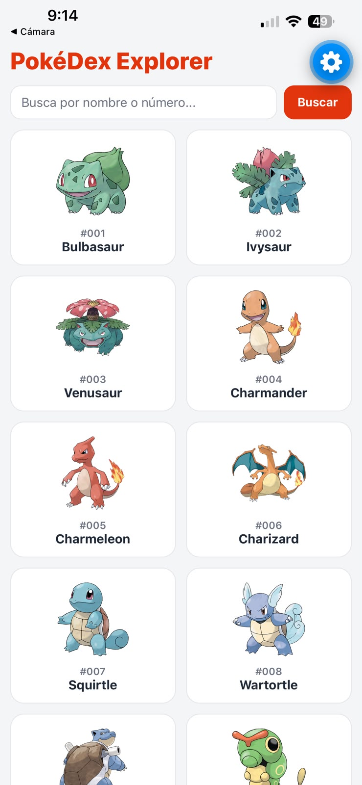
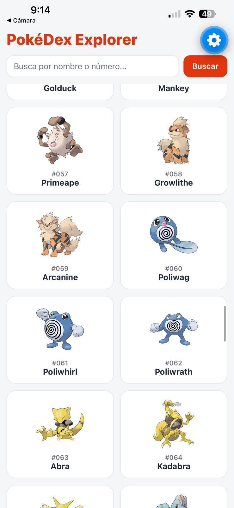
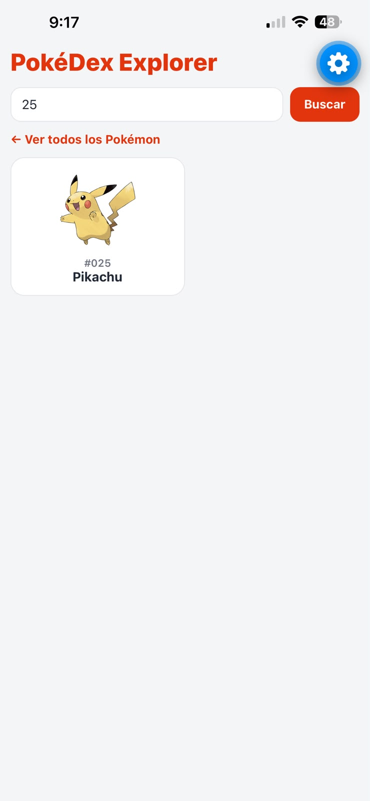
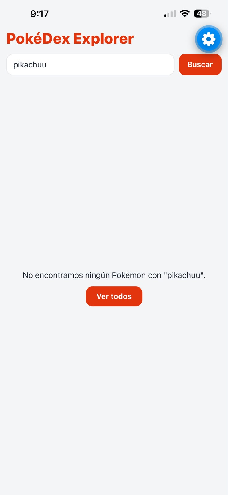
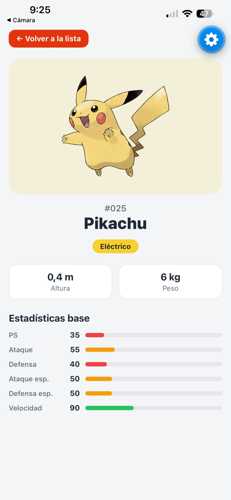
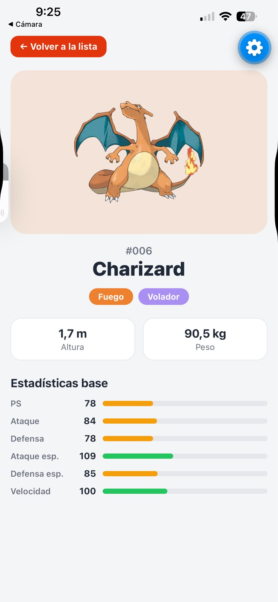
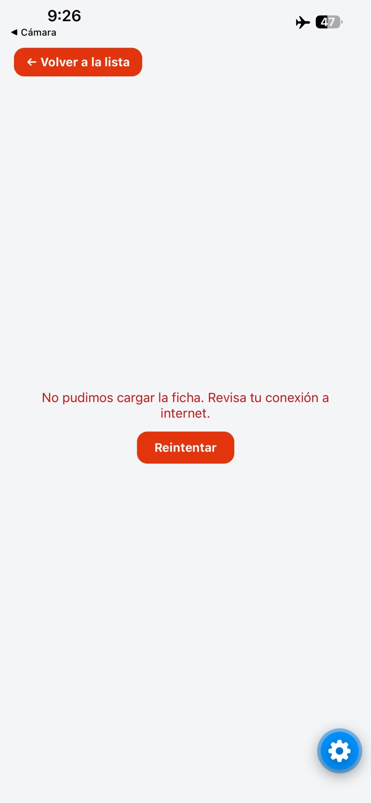
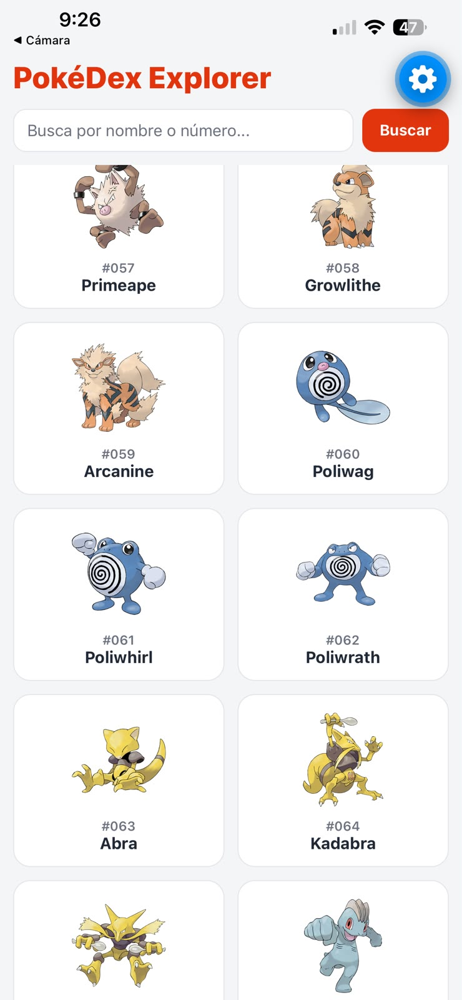

# PokéDex Explorer

App móvil hecha con **React Native + Expo** que consume la [PokéAPI](https://pokeapi.co/): lista los Pokémon en una cuadrícula con scroll infinito, permite buscarlos por nombre o número y muestra la ficha de cada uno con imagen, tipos, altura, peso y estadísticas base.

Taller *Consumo de API con React Native y Expo — PokéDex* · Desarrollo Móvil · Ingeniería de Software.

**Integrante:** Fray ([@sebas570be](https://github.com/sebas570be))

---

## Cómo ejecutarlo

Requisitos: Node.js y la app **Expo Go** en el celular (el proyecto usa **Expo SDK 58**, la misma versión de Expo Go disponible en iOS).

```bash
git clone https://github.com/sebas570be/pokedex-explorer.git
cd pokedex-explorer
npm install
npx expo start
```

Escanear el QR con la cámara (iOS) o con Expo Go (Android). No se necesita API key ni librería HTTP: `fetch` viene incluido en React Native.

---

## Funcionalidades

**Vista de lista**
- Encabezado "PokéDex Explorer" y barra de búsqueda (nombre o número; ignora mayúsculas, espacios al inicio/final, `#` y ceros a la izquierda: `  #025 ` → `25`).
- Cuadrícula de 2 columnas con imagen, número de 3 dígitos (`#025`) y nombre con mayúscula inicial.
- Carga 20 Pokémon al abrir y 20 más al llegar al final (scroll infinito), con indicador de carga al pie de la lista.
- Tocar una tarjeta abre la ficha.

**Vista de detalle**
- Imagen grande (fondo con el color del tipo principal), nombre y número.
- Un distintivo por tipo, cada uno con su propio color y su nombre en español.
- Altura en metros y peso en kilogramos (la API los envía en decímetros y hectogramos → se dividen entre 10).
- Las 6 estadísticas base con su valor y una barra de ancho proporcional al máximo posible (255).
- Botón "Volver a la lista" (y botón físico "atrás" en Android).

**Estados de la interfaz** (en las dos vistas)

| Estado | Qué ve el usuario |
|---|---|
| Cargando | Indicador de carga con texto |
| Error | Mensaje en español y botón "Reintentar" |
| Sin resultados | Mensaje cuando el nombre o número buscado no existe (respuesta 404) |
| Éxito | La lista o la ficha |

---

## Arquitectura

```
pokedex-explorer/
├── App.js                         Raíz: SafeAreaProvider y decide qué vista se ve (lista o ficha)
├── api/
│   └── pokeApi.js                 ÚNICO archivo que hace fetch a la PokéAPI
├── hooks/
│   ├── usePokemonList.js          Estado de la lista: carga inicial, paginación, búsqueda y errores
│   └── usePokemonDetail.js        Estado de la ficha: cargando, error, no encontrado, éxito
├── screens/
│   ├── PokemonListScreen.jsx      Vista de lista (solo dibuja; los datos vienen del hook)
│   └── PokemonDetailScreen.jsx    Vista de detalle (solo dibuja; los datos vienen del hook)
├── components/
│   ├── PokemonCard.jsx            Tarjeta de la cuadrícula
│   ├── SearchBar.jsx              TextInput + botón "Buscar"
│   ├── StatusView.jsx             Estados cargando / error / sin resultados (reutilizado en ambas vistas)
│   ├── TypeBadge.jsx              Distintivo de un tipo con su color
│   └── StatBar.jsx                Estadística con barra proporcional a 255
├── constants/
│   ├── colors.js                  Paleta general de la app
│   ├── typeColors.js              Color y nombre en español de cada tipo
│   └── statLabels.js              Nombres de las estadísticas en español y MAX_STAT = 255
├── utils/
│   └── format.js                  Funciones puras: #025, mayúscula inicial, id desde la URL, unidades, normalizar búsqueda
└── docs/capturas/                 Capturas de la app funcionando
```

### Por qué lo organizamos así

La regla del taller era que las llamadas a la API no quedaran mezcladas con el JSX y los estilos. Separamos la app en **capas**, cada una con una sola responsabilidad:

```
screens / components  →  hooks  →  api  →  PokéAPI
   (qué se ve)          (estado)   (red)
```

1. **`api/`** solo sabe hablar con el servidor: arma la URL, hace el `fetch`, revisa `response.ok` y transforma la respuesta enorme de la API en un objeto pequeño (`{ id, name, image, types, stats, ... }`). Si mañana cambia la URL o se usa Axios, solo se toca este archivo.
2. **`hooks/`** maneja el estado de cada vista (cargando, error, datos, página actual) y decide **cuándo** se hace una petición con `useEffect`.
3. **`screens/`** y **`components/`** solo dibujan lo que reciben. No conocen la URL ni hacen `fetch`.
4. **`utils/`** y **`constants/`** son funciones y valores reutilizables sin estado.

**Navegación sin librería:** la guía pide una pantalla principal con dos vistas y la plantilla `blank` no trae navegación. En `App.js` un `useState` (`selectedPokemonId`) decide qué se ve. La ficha se dibuja **encima** de la lista, sin desmontarla, así al volver se conservan los Pokémon cargados y la posición del scroll, y no se repite la petición.

### Decisiones técnicas

- **`response.ok` antes de `response.json()`**: `fetch` no lanza error con 404/500, solo cuando no hay red. Un nombre inexistente responde 404 con texto plano; llamar `json()` sobre eso fallaría. El error lleva el `status`, y así la UI distingue "no existe" (404) de "sin conexión".
- **`useEffect` con dependencias controladas**: la lista se carga una sola vez al montar (`[loadPage]`, función estable con `useCallback`); la ficha se recarga solo si cambia el Pokémon o se presiona "Reintentar" (`[pokemonId, reloadKey]`). La función de limpieza ignora respuestas que llegan tarde.
- **`FlatList`** con `numColumns={2}`, `keyExtractor` (string único) y `onEndReached` en vez de `ScrollView` + `map`: solo renderiza lo visible.
- **`useRef` como candado de paginación**: `onEndReached` puede dispararse varias veces seguidas; el ref bloquea peticiones duplicadas sin provocar renders.
- **Imagen de la lista armada con el id** (`official-artwork/{id}.png`): evita pedir 20 fichas completas solo para mostrar 20 imágenes.
- **Accesibilidad**: `accessibilityRole` y `accessibilityLabel` en tarjetas, botones, tipos y estadísticas; texto oscuro sobre tipos de color claro para mantener contraste.

---

## Capturas

| Lista | Scroll infinito | Búsqueda por número | Sin resultados |
|---|---|---|---|
|  |  |  |  |

| Ficha (1 tipo) | Ficha (2 tipos) | Error sin conexión | Volver conserva el scroll |
|---|---|---|---|
|  |  |  |  |

Todas las capturas están en [`docs/capturas/`](docs/capturas/).

---

## Tecnologías

- React Native 0.88 + React 19.3 + Expo SDK 58 (plantilla `blank`, JavaScript)
- `react-native-safe-area-context`
- `fetch` + `async/await`
- PokéAPI v2 (`/pokemon?limit&offset` y `/pokemon/{nombre o id}`)
